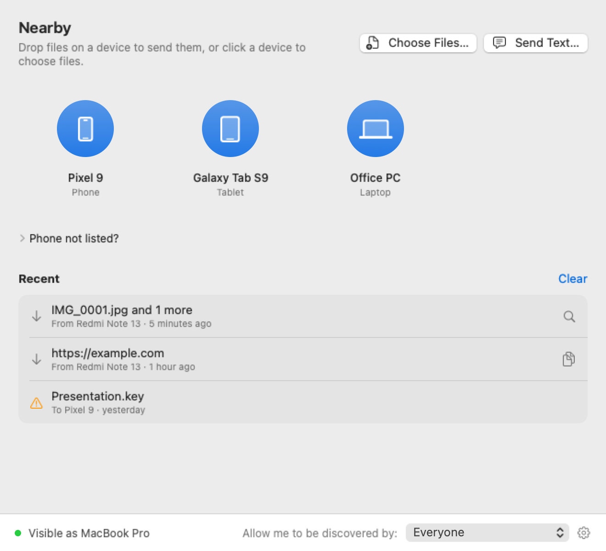
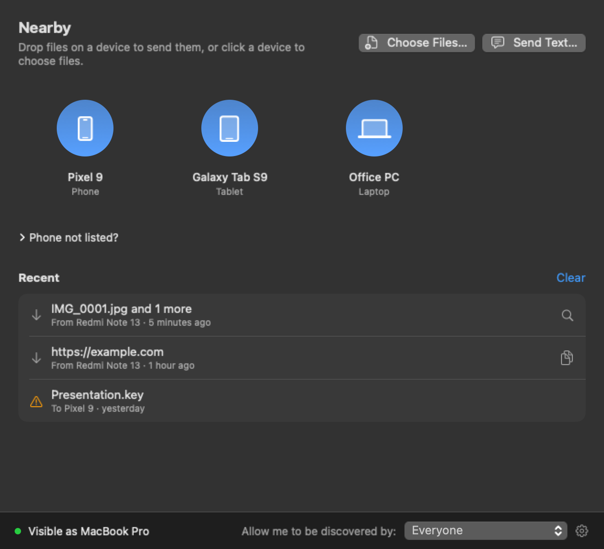
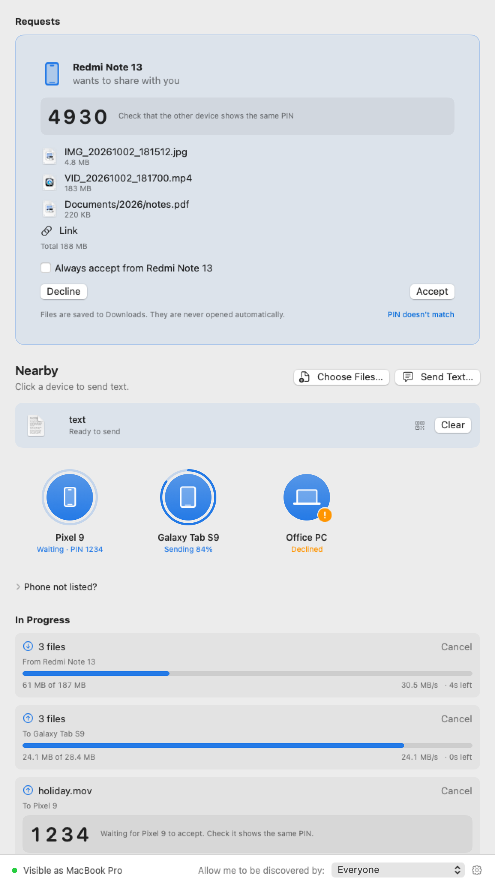
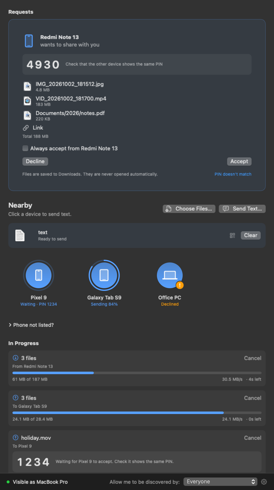
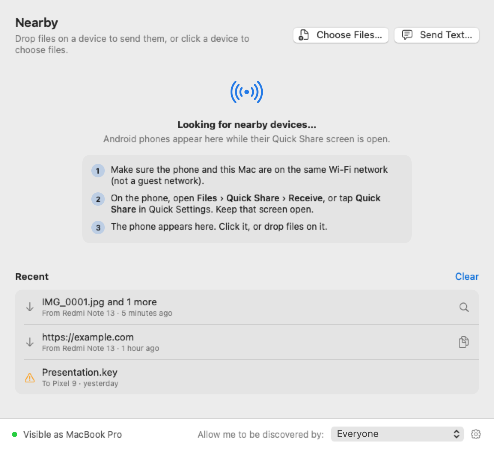
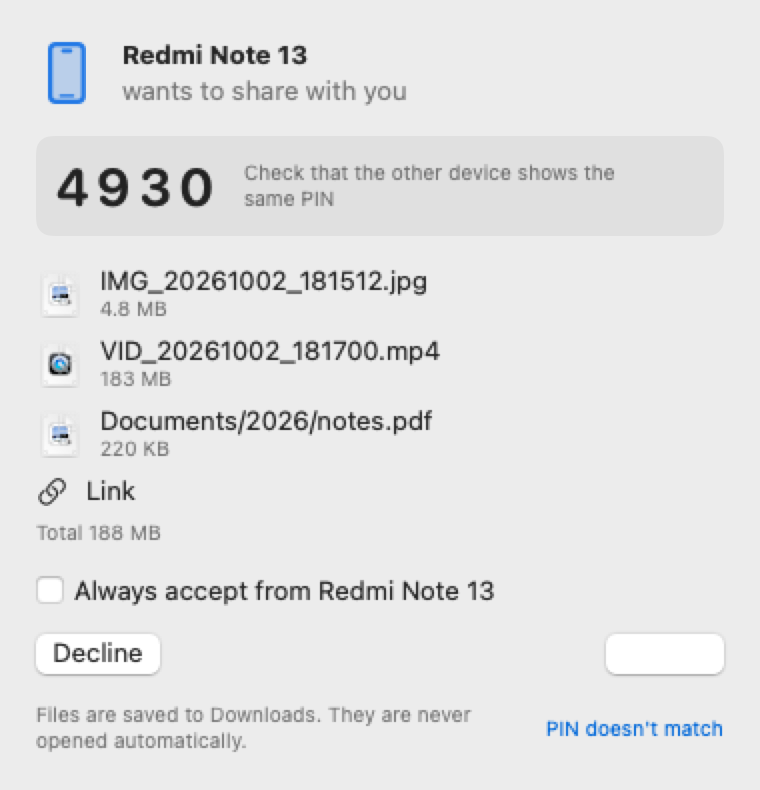
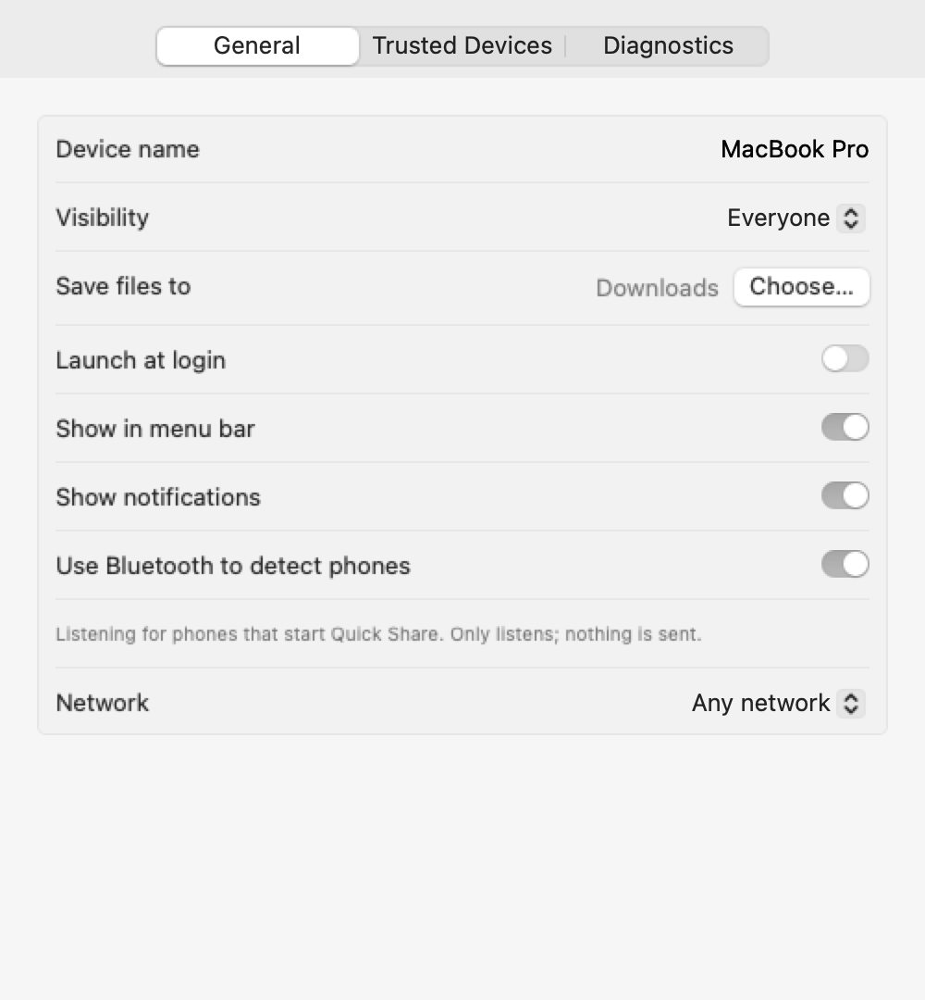
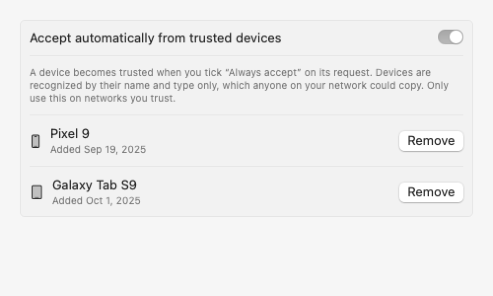

# New UI screenshots (for review)

Rendered from the app with `./scripts/make-screenshots.sh --out docs/screenshots-new` on macOS 15 (CI),
at 2x, with neutral sample data (device name "MacBook Pro", sample phones). Nothing here is used by the
README or the documentation site yet; `docs/images/` still holds the old popover screenshots.

## Main window

| Light | Dark |
|---|---|
|  |  |

**Busy:** a request waiting, sending with progress rings on the devices, PIN check, a declined send.

| Light | Dark |
|---|---|
|  |  |

| Searching (no devices yet) | QR code (experimental) |
|---|---|
|  |  |

## Menu bar menu

| Busy, light | Busy, dark | Idle, light | Idle, dark |
|---|---|---|---|
|  |  |  |  |

The menu is a real macOS menu; these images show its custom rows (status, request, transfers) as they
render, with the standard items drawn alongside for reference.

## Incoming request

Shown inside the main window, or in a small panel when notifications are off.

| Light | Dark |
|---|---|
|  |  |

## Settings

| Window | General | Trusted Devices | Diagnostics |
|---|---|---|---|
|  |  |  |  |

## Received text

