# New UI screenshots (for review)

Rendered from the app with `./scripts/make-screenshots.sh --out docs/screenshots-new` on macOS 15 (CI),
at 2x, with neutral sample data (device name "MacBook Pro", sample phones). Nothing here is used by the
README or the documentation site yet; `docs/images/` still holds the old popover screenshots.

## App icon

An original mark: an S of two arcs with ball ends, its middle bar split into two arrows meeting in the
centre (send → ← receive). Drawn by `scripts/make-icon.swift`. On macOS 26 with the Dark icon style,
macOS darkens it automatically (charcoal tile, blue S).

## Main window

The main window has a sidebar with four pages: **Send** (⌘1), **Receive** (⌘2), **History** (⌘3) and
**Settings** (⌘,). The sidebar shows a badge when a request is waiting or a transfer is running, and the
bottom of the sidebar shows whether this Mac can be found.

## Send

| Light | Dark |
|---|---|
| 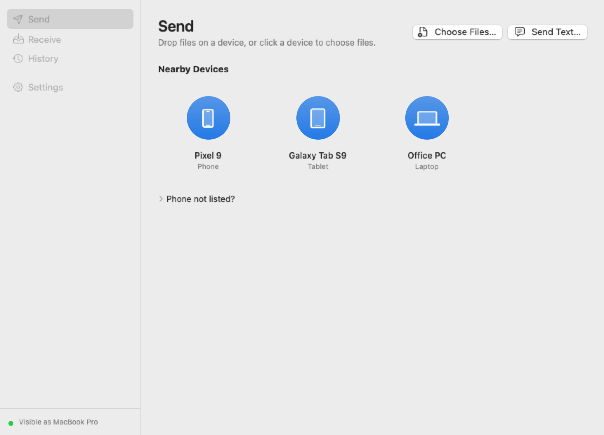 | 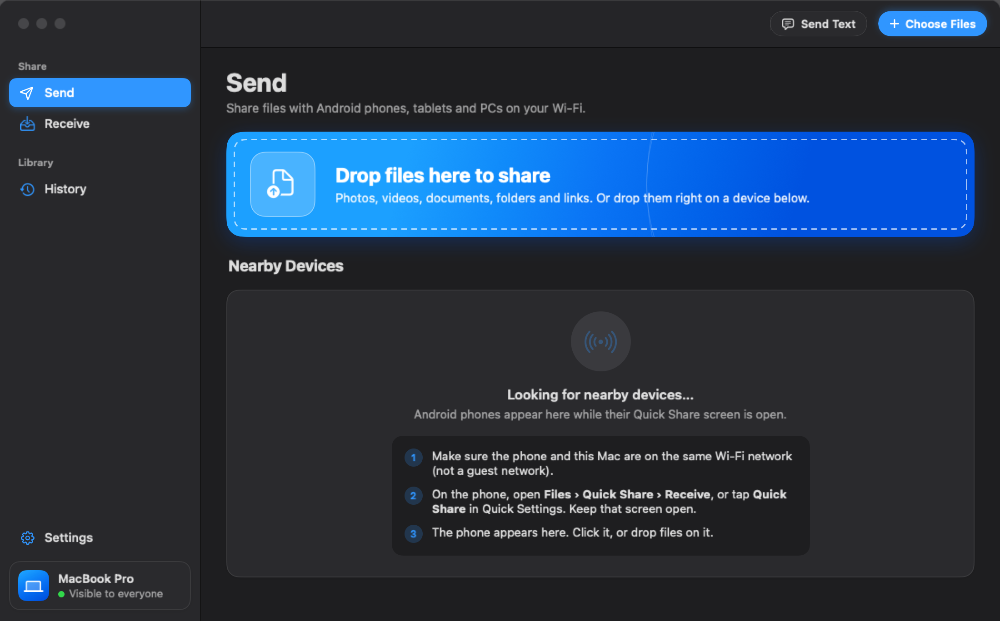 |

**Busy:** a received link (banner with Open Link / Copy), a request waiting (strip with Accept and
Decline), an item to send, progress rings and PIN on the devices, a declined send, and the transfers
in progress.

| Light | Dark |
|---|---|
|  |  |

| Searching (no devices yet) | QR code (experimental) |
|---|---|
|  | 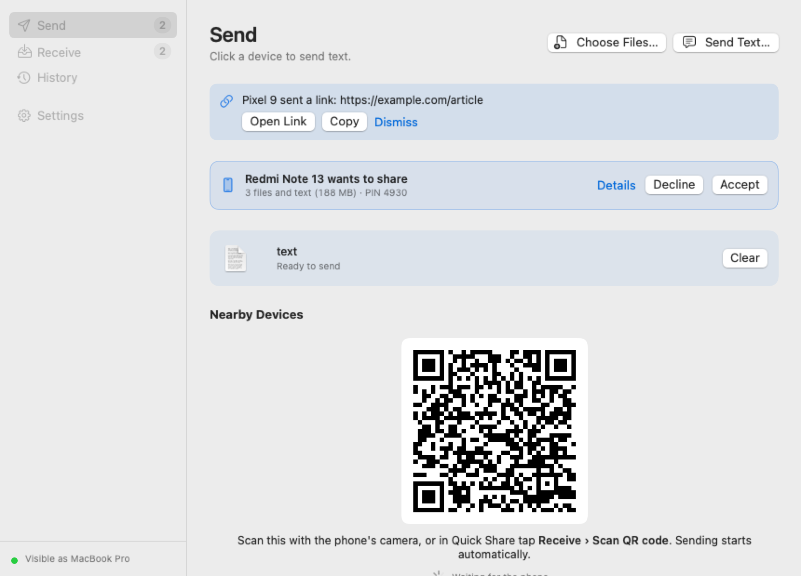 |

## Receive

| Light | Dark |
|---|---|
| 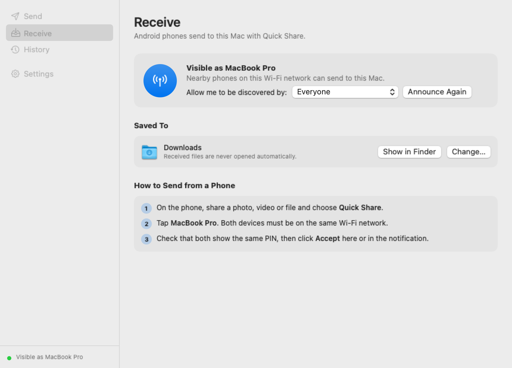 | 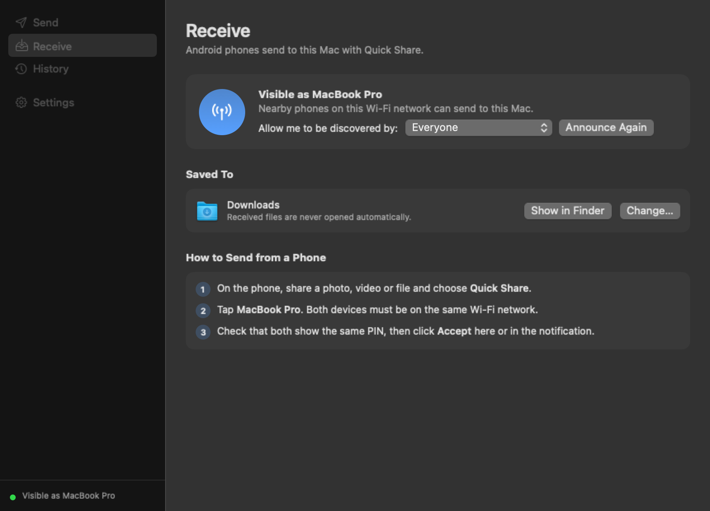 |

**Busy:** a request with its PIN, and a transfer coming in.

| Light | Dark |
|---|---|
|  | 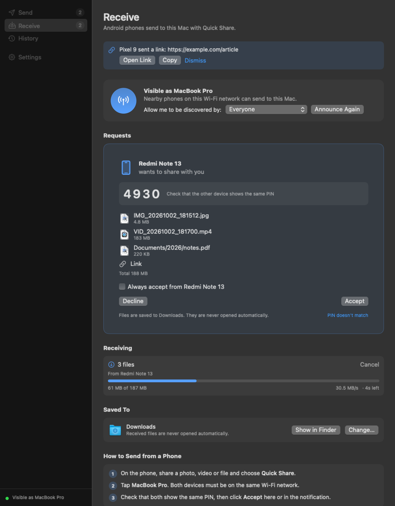 |

## History

Search with ⌘F; click a row and press Return (or double-click) to open it.

| Light | Dark |
|---|---|
| 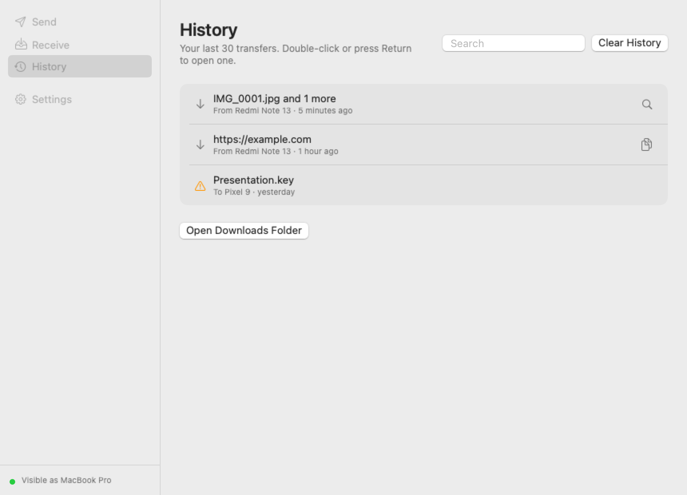 |  |

## Settings

| Light | Dark |
|---|---|
|  | 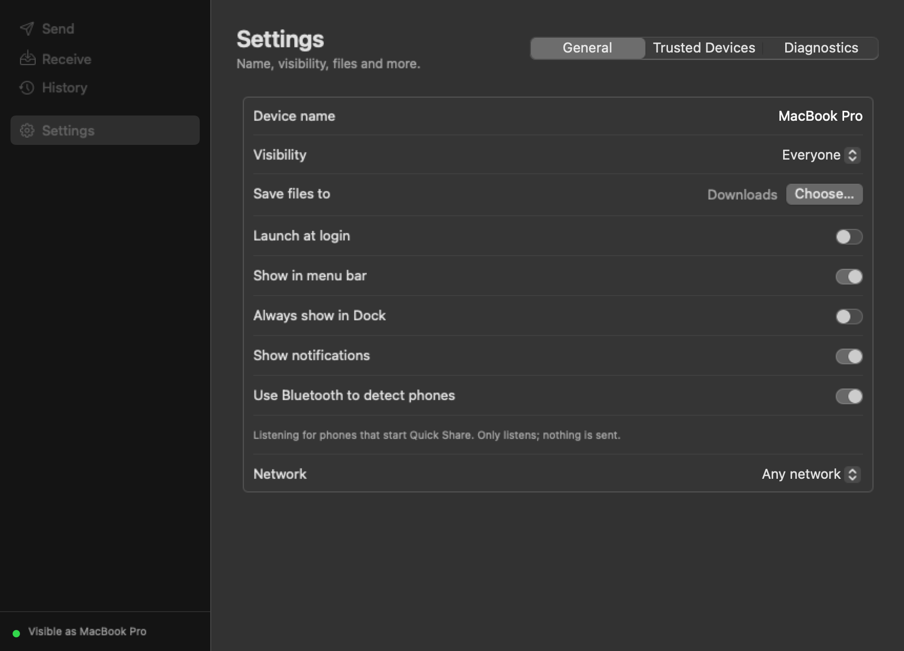 |

| General | Trusted Devices | Diagnostics |
|---|---|---|
| 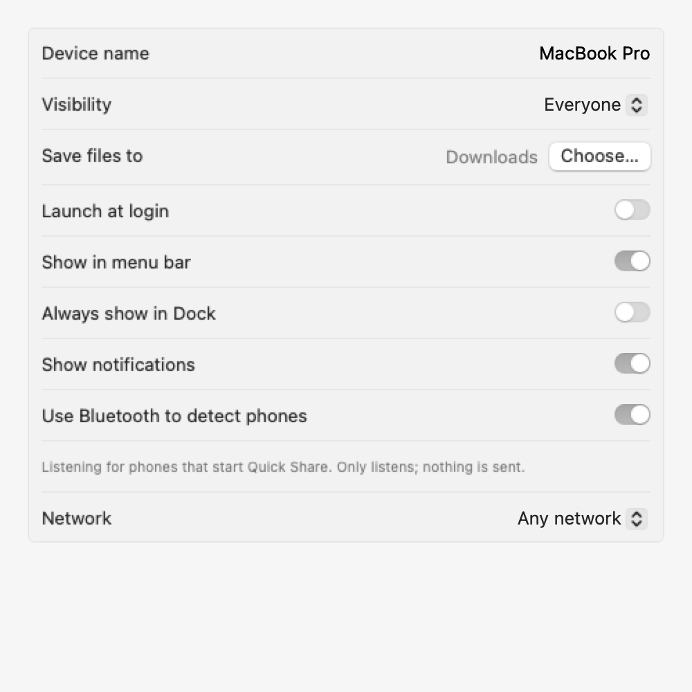 |  | 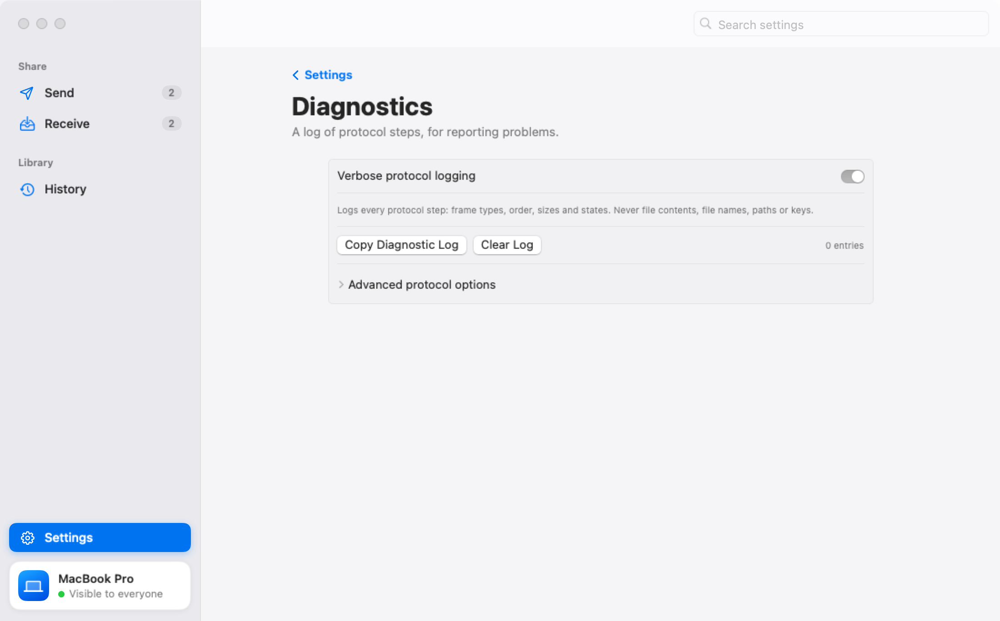 |

## Menu bar menu

| Busy, light | Busy, dark | Idle, light | Idle, dark |
|---|---|---|---|
|  |  | 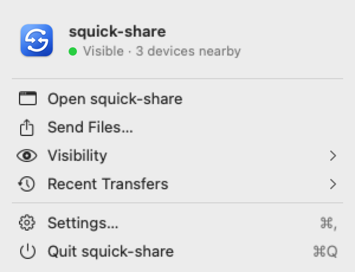 |  |

The menu is a real macOS menu; these images show its custom rows (status, request, transfers) as they
render, with the standard items drawn alongside for reference.

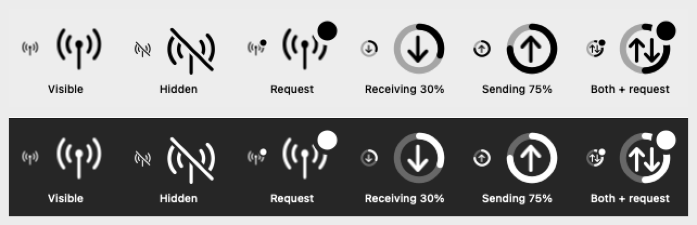

## Incoming request

As it appears on the Receive page. There is no pop-up window: requests arrive as a notification with
Accept and Decline, and wait in the window and the menu bar.

| Light | Dark |
|---|---|
|  |  |

Received links and text arrive as a notification with Open Link and Copy, and as a banner in the
window (see Send, busy). No window pops up.
