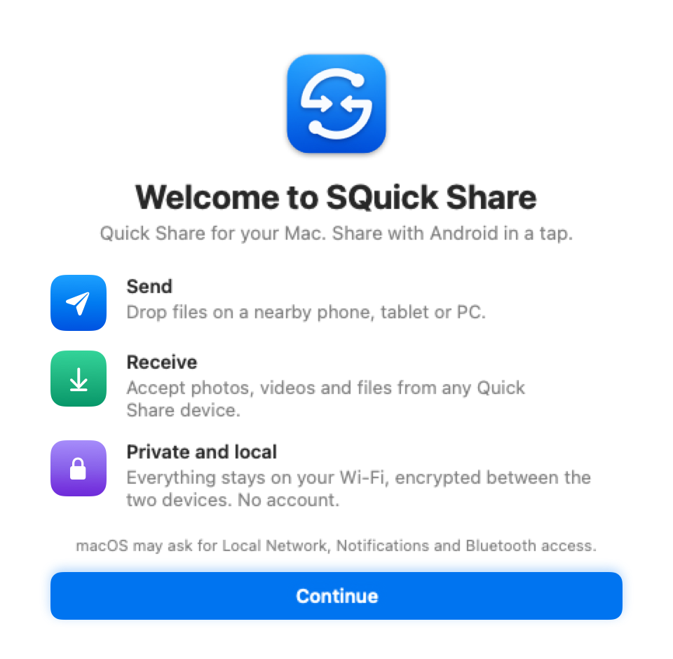
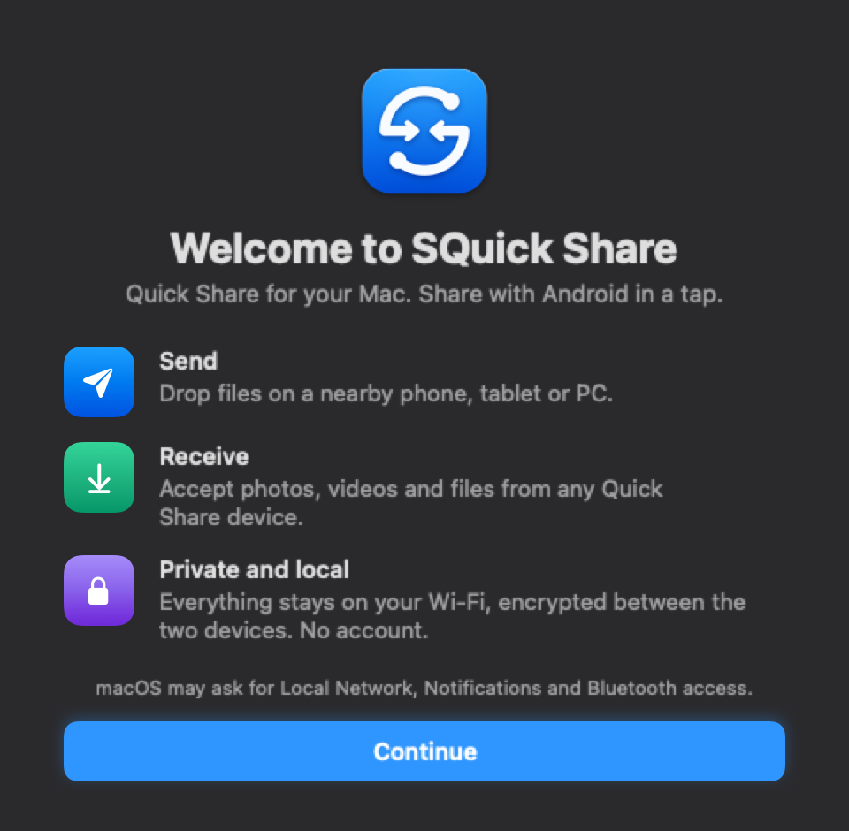
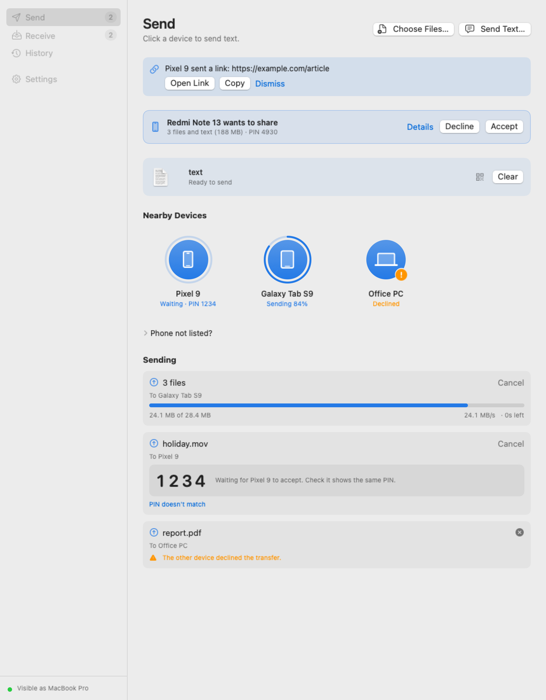
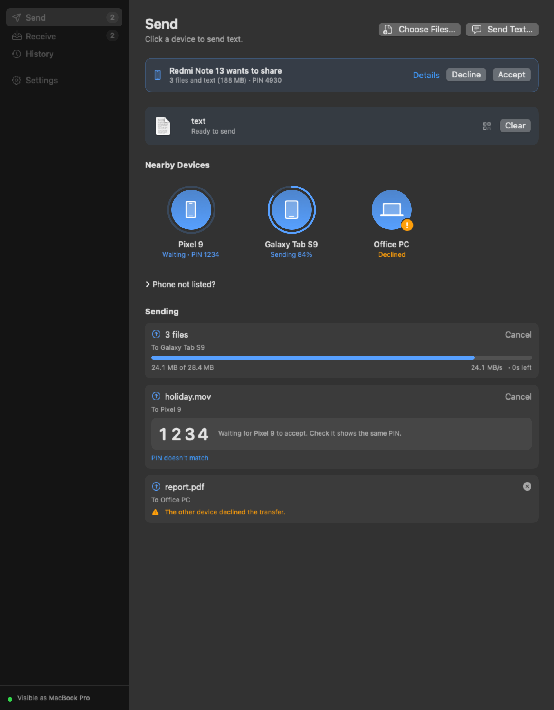
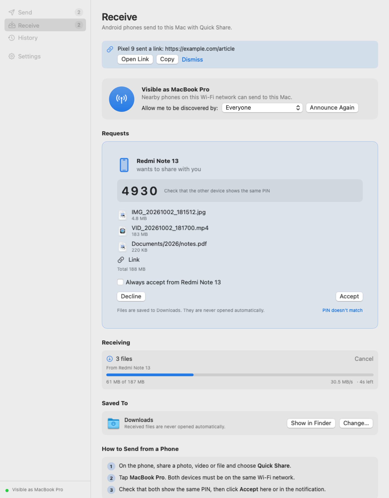
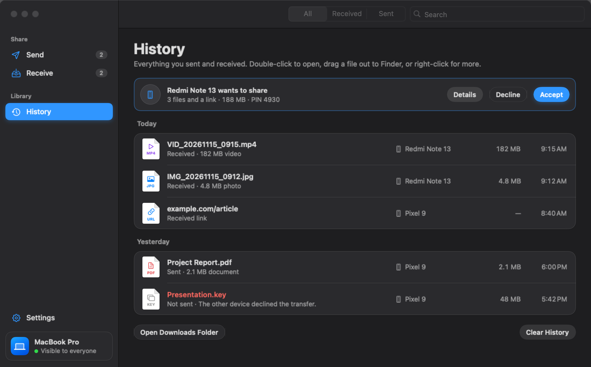
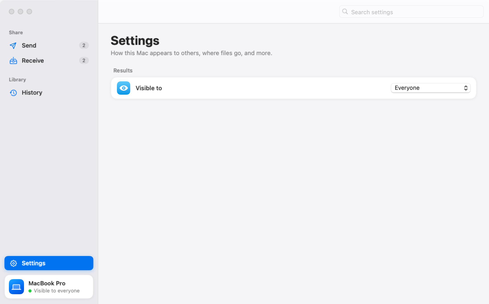
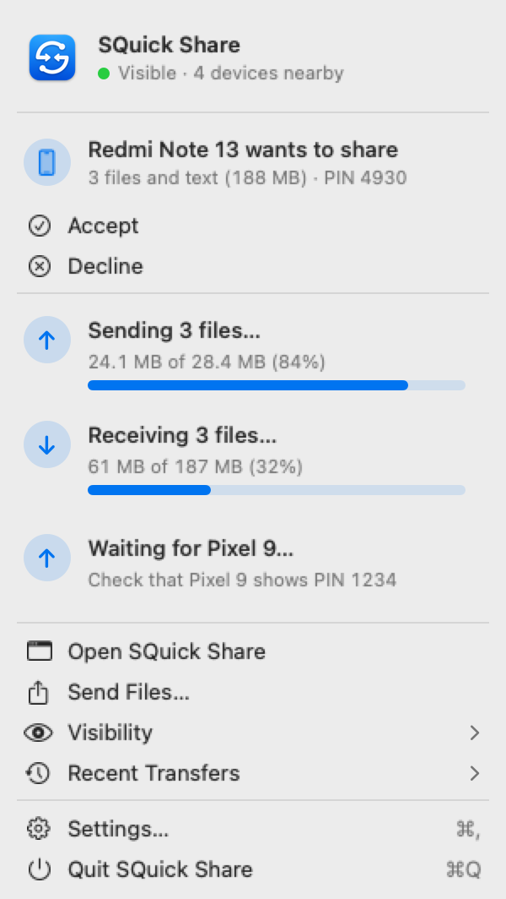
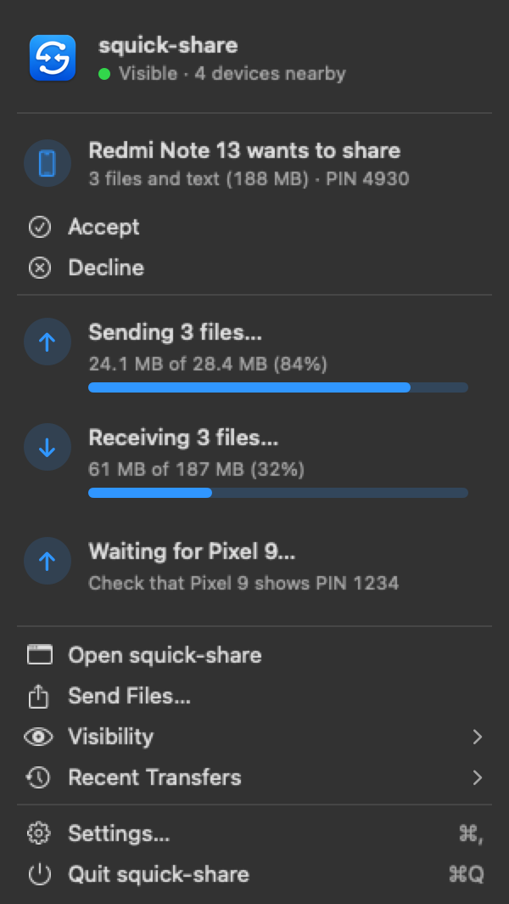

# New UI screenshots (for review)

Rendered from the app with `./scripts/make-screenshots.sh --out docs/screenshots-new` on macOS 15 (CI),
at 2x, with neutral sample data (device name "MacBook Pro", sample phones). Nothing here is used by the
README or the documentation site yet; `docs/images/` still holds the old popover screenshots.

## App icon

An original mark: an S of two arcs with ball ends, its middle bar split into two arrows meeting in the
centre (send → ← receive), on a rich Apple-style blue (sky blue at the top to deep blue at the
bottom). The app's accent colour uses the same blue. Drawn by `scripts/make-icon.swift`. On macOS 26 with the Dark icon style,
macOS darkens it automatically (charcoal tile, blue S).

## Main window

The main window has a sidebar with four pages: **Send** (⌘1), **Receive** (⌘2), **History** (⌘3) and
**Settings** (⌘,). The sidebar shows a badge when a request is waiting or a transfer is running, and the
"This Mac" card at the bottom shows whether this Mac can be found. The toolbar's buttons change with the
page: Send Text and Choose Files on Send, the Downloads folder on Receive, a filter and search on
History, and a search field on Settings.

## Welcome

Shown once, the first time the window opens.

| Light | Dark |
|---|---|
|  |  |

## Send

| Light | Dark |
|---|---|
|  |  |

**Busy:** a request waiting (strip with Accept and Decline), progress rings and the PIN on the devices,
a finished send, and a transfer in progress with its document icons.

| Light | Dark |
|---|---|
|  |  |

| Searching (no devices yet) | QR code (experimental) |
|---|---|
|  |  |

## Receive

| Light | Dark |
|---|---|
|  |  |

**Busy:** a request with its document icons, PIN digits, Accept and Decline, and a transfer coming in.

| Light | Dark |
|---|---|
|  |  |

## History

Grouped by day. Filter with All / Received / Sent, search with ⌘F, double-click (or select and press
Return) to open, right-click for Show in Finder, Copy and Remove, or drag a received file out to Finder.

| Light | Dark |
|---|---|
|  |  |

## Settings

| Light | Dark |
|---|---|
|  |  |

| Search | Trusted Devices | Diagnostics |
|---|---|---|
|  |  |  |

## Menu bar menu

| Busy, light | Busy, dark | Idle, light | Idle, dark |
|---|---|---|---|
|  |  |  |  |

The menu is a real macOS menu; these images show its custom rows (status, request, transfers) as they
render, with the standard items drawn alongside for reference.

## Requests and received text

There is no pop-up window: requests arrive as a notification with Accept and Decline, and wait on the
Receive page (see Receive, busy) and in the menu bar. Received links and text arrive as a notification
with Open Link and Copy, and as a banner in the window. No window pops up.
