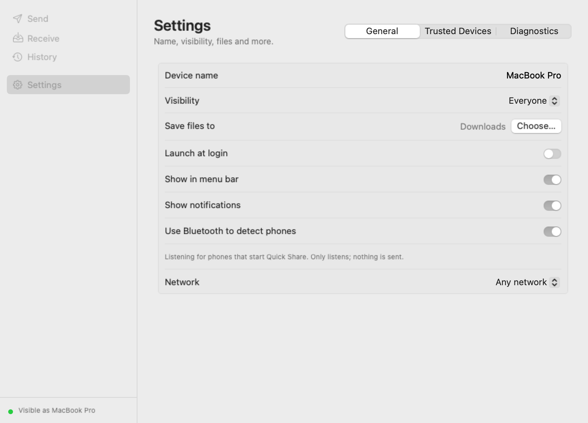
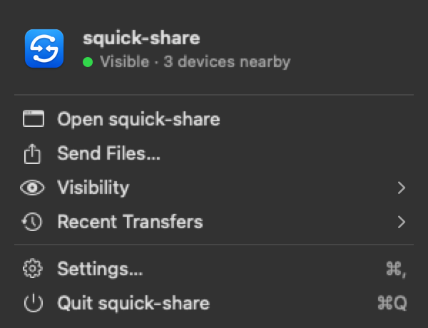
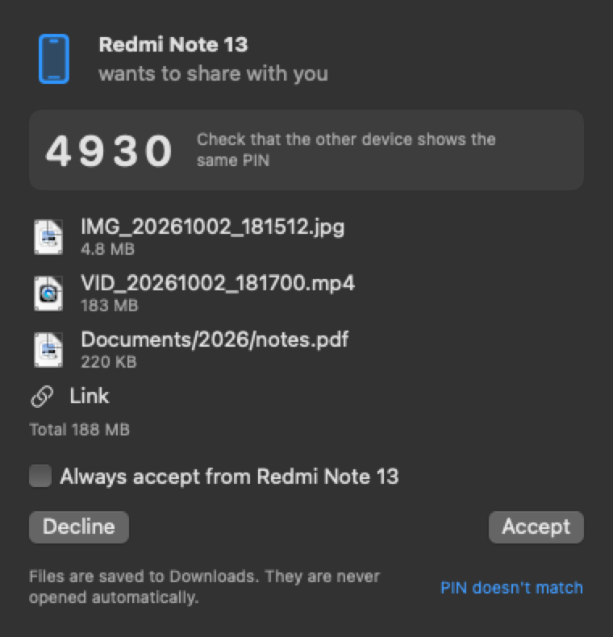
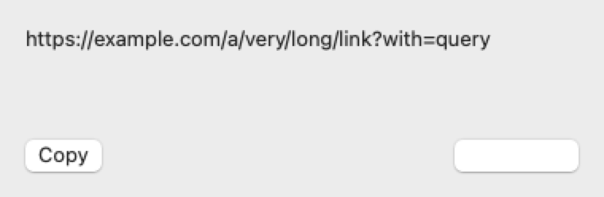

# New UI screenshots (for review)

Rendered from the app with `./scripts/make-screenshots.sh --out docs/screenshots-new` on macOS 15 (CI),
at 2x, with neutral sample data (device name "MacBook Pro", sample phones). Nothing here is used by the
README or the documentation site yet; `docs/images/` still holds the old popover screenshots.

The main window has a sidebar with four pages: **Send** (⌘1), **Receive** (⌘2), **History** (⌘3) and
**Settings** (⌘,). The sidebar shows a badge when a request is waiting or a transfer is running, and the
bottom of the sidebar shows whether this Mac can be found.

## Send

| Light | Dark |
|---|---|
|  |  |

**Busy:** a request waiting (strip at the top), an item to send, progress rings and PIN on the devices,
a declined send, and the transfers in progress.

| Light | Dark |
|---|---|
|  |  |

| Searching (no devices yet) | QR code (experimental) |
|---|---|
|  |  |

## Receive

| Light | Dark |
|---|---|
|  |  |

**Busy:** a request with its PIN, and a transfer coming in.

| Light | Dark |
|---|---|
|  |  |

## History

| Light | Dark |
|---|---|
|  |  |

## Settings

| Light | Dark |
|---|---|
|  |  |

| General | Trusted Devices | Diagnostics |
|---|---|---|
|  |  |  |

## Menu bar menu

| Busy, light | Busy, dark | Idle, light | Idle, dark |
|---|---|---|---|
|  |  |  |  |

The menu is a real macOS menu; these images show its custom rows (status, request, transfers) as they
render, with the standard items drawn alongside for reference.

## Incoming request panel

Shown only when notifications are off; it floats without taking keyboard focus.

| Light | Dark |
|---|---|
|  |  |

## Received text

